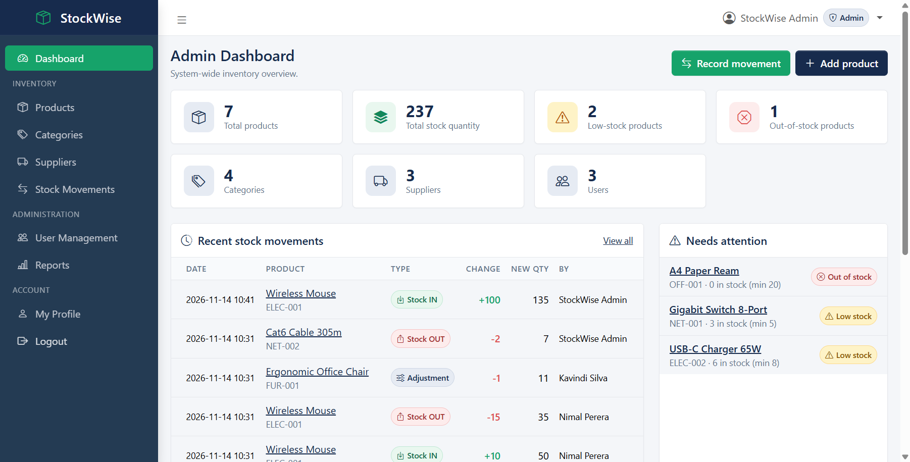
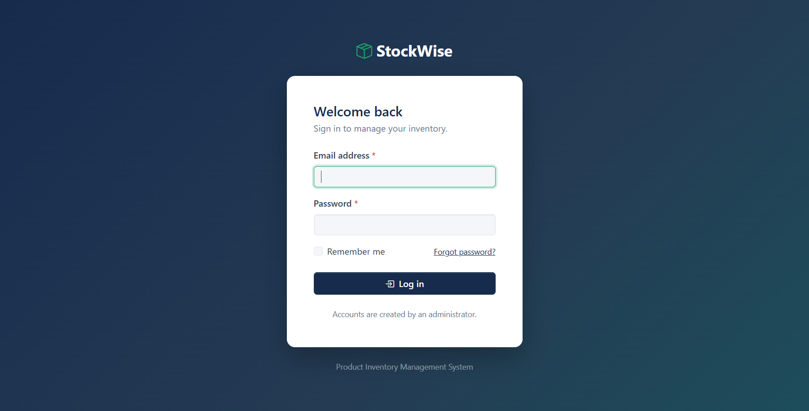
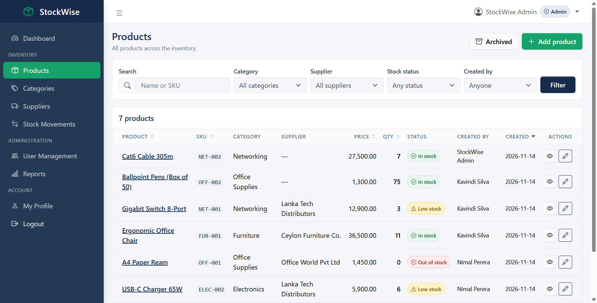
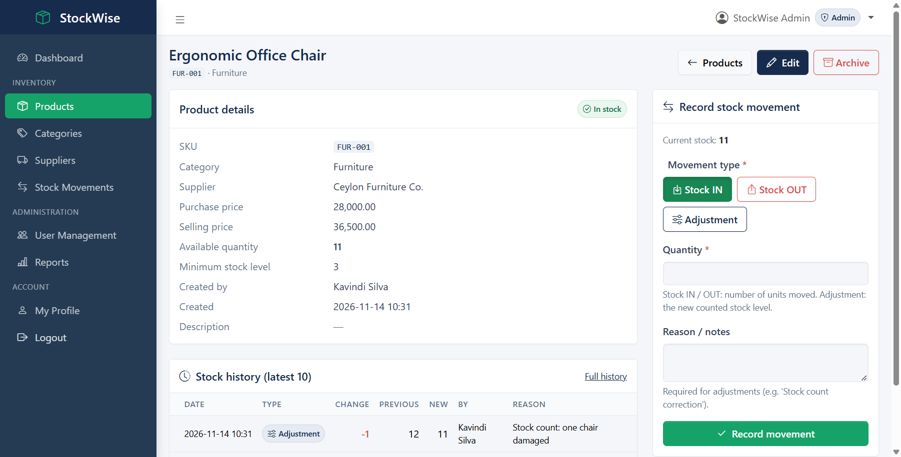
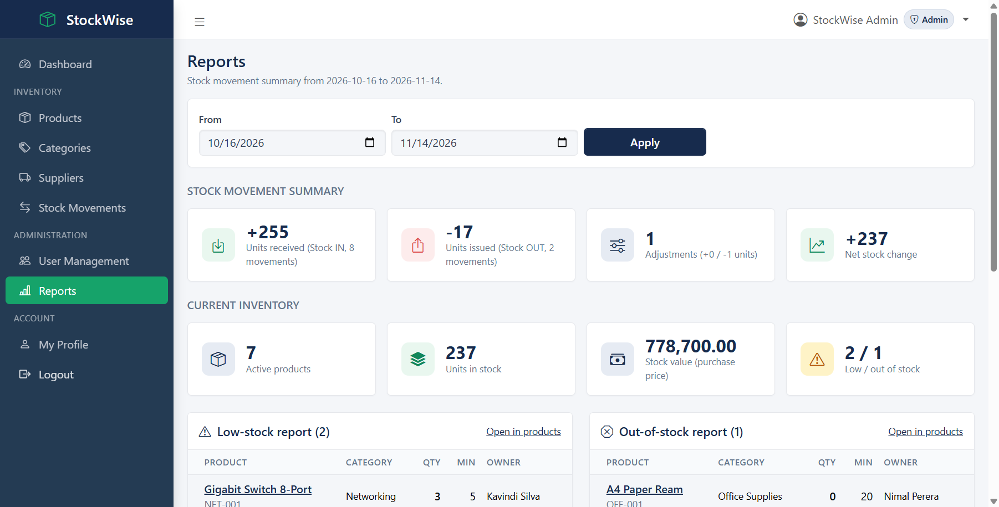

# StockWise — Product Inventory Management System

StockWise is a Laravel web application for managing products, stock levels and stock movements, with two roles (**Admin** and **Staff**), role-based dashboards and a fully auditable stock history. It was built for the Apps Technologies Laravel technical evaluation.



## Features

| Area | What it does |
|---|---|
| Authentication | Laravel Breeze login/logout, password reset, "remember me", login throttling. Public registration is **disabled** — accounts are created by an Admin. Inactive users cannot log in and are signed out on their next request. |
| Roles & access | `role` middleware for the `/admin/*` and `/staff/*` areas, `ProductPolicy` for record-level ownership. Admin sees everything; Staff only their own products and movements. Role-aware redirect after login. |
| Dashboards | Admin: totals for products, categories, suppliers, users, stock quantity, low-stock and out-of-stock counts, recent movements, stock by category. Staff: the same figures limited to their own products. All values come from the database. |
| Products (core CRUD) | Create, list, view, edit, archive (soft delete). Search by name/SKU, filter by category, supplier, stock status and creator (admin), sortable columns, pagination that keeps the query string, optional image upload. SKU is unique (including archived products). |
| Stock management | Stock IN, Stock OUT and Adjustment (counted quantity + required reason) through a single `StockService` that uses a DB transaction with `lockForUpdate()`. Stock can never go negative, every change writes a movement record (previous/new quantity, user, reason) and movements cannot be edited or deleted. Editing a product never changes its quantity. |
| Categories & suppliers | Admin CRUD with search and pagination; deletion is blocked while any product (including archived) uses the record. |
| User management | Admin-only list/search/filter, create, edit, change role, activate/deactivate. An admin cannot demote/deactivate themselves and the last active admin is always protected. Users are never hard-deleted. |
| Reports | Date-range summary of units in/out and adjustments, net change, inventory value, low-stock and out-of-stock reports, most active products. |
| Profile | Update name and email (unique), change password (current password required). Role cannot be changed here. |
| UI | AdminLTE 4 + Bootstrap 5 integrated through Blade layouts, partials and components; Navy / Emerald / Light-grey palette; flash messages, inline validation errors, confirmation dialogs, empty states, responsive layout, themed error pages. |

### Business rules worth knowing

- **Stock status** (used everywhere): *Out of stock* = 0; *Low stock* = 0 < quantity ≤ minimum level; *In stock* = quantity > minimum level.
- **Initial quantity** entered when creating a product is recorded as a `Stock IN` movement ("Initial stock").
- **Archiving** a product requires its stock to be **0** first (record a Stock OUT or Adjustment). Archived products disappear from listings, keep their full movement history and can be restored by an Admin (`Products → Archived`).

## Technology stack

- PHP **8.4** (Laravel 13 requires PHP ≥ 8.3), Laravel **13**
- MySQL 8 (development/production), SQLite in-memory (automated tests)
- Laravel Breeze (Blade), Blade components
- AdminLTE 4, Bootstrap 5.3, Bootstrap Icons, built with Vite
- PHPUnit 12, Laravel Pint

## Prerequisites

- PHP 8.3+ with extensions: `pdo_mysql`, `mbstring`, `openssl`, `fileinfo`, `tokenizer`, `xml`, `ctype`, `bcmath`, `curl`, `gd` (image uploads/tests), `pdo_sqlite` (tests)
- Composer 2
- Node.js 20+ and npm
- MySQL 8 (or MariaDB 10.6+)

## Installation

```bash
git clone <your-repository-url> stockwise
cd stockwise

composer install
npm install

cp .env.example .env          # Windows PowerShell: Copy-Item .env.example .env
php artisan key:generate
```

### Configure the database

Create an empty database, for example:

```sql
CREATE DATABASE stockwise CHARACTER SET utf8mb4 COLLATE utf8mb4_unicode_ci;
```

Then set the connection in `.env` (never commit this file):

```dotenv
DB_CONNECTION=mysql
DB_HOST=127.0.0.1
DB_PORT=3306
DB_DATABASE=stockwise
DB_USERNAME=root
DB_PASSWORD=your-local-password
```

### Migrate, seed and link storage

```bash
php artisan migrate --seed     # creates tables + demo data (refuses to seed when APP_ENV=production)
php artisan storage:link       # makes uploaded product images publicly reachable
npm run build                  # or `npm run dev` while developing
```

## Running the application

```bash
php artisan serve
```

Open <http://localhost:8000> — you will be redirected to the login page.

### Demo accounts (local development only)

| Role | Email | Password |
|---|---|---|
| Admin | `admin@stockwise.test` | `password` |
| Staff | `staff1@stockwise.test` | `password` |
| Staff | `staff2@stockwise.test` | `password` |

The seeder also creates 4 categories, 3 suppliers, 7 products owned by different users and a few stock movements. Change or remove these accounts before any real deployment.

## Running the tests

```bash
php artisan test
```

Tests use an in-memory SQLite database (see `phpunit.xml`), so they never touch your MySQL data. The suite covers authentication and role redirects, inactive users, role middleware, product ownership (including crafted direct requests), product CRUD validation, soft deletion and history preservation, stock IN/OUT/adjustment rules, transaction rollback, categories/suppliers, user management safeguards, dashboard figures and reports.

Code style: `./vendor/bin/pint --test`

## Project structure (main parts)

```
app/
  Http/Controllers/
    Admin/DashboardController.php, Admin/ReportController.php
    Staff/DashboardController.php
    DashboardController.php          # role-aware /dashboard redirect
    ProductController.php            # shared by /admin and /staff areas
    CategoryController.php, SupplierController.php
    StockMovementController.php, UserManagementController.php
  Http/Middleware/RoleMiddleware.php, EnsureUserIsActive.php
  Http/Requests/                     # Form Request validation
  Models/User, Product, Category, Supplier, StockMovement
  Policies/ProductPolicy.php
  Services/StockService.php          # the only place quantities change
database/migrations, factories, seeders
resources/views/layouts, partials, components, products, stock, ...
routes/web.php                       # named, grouped routes
tests/Feature, tests/Unit
```

## Screenshots

| Login | Products |
|---|---|
|  |  |

| Product & stock movement | Reports |
|---|---|
|  |  |

## Notes

- Implementation progress, decisions and verification results are tracked in [`IMPLEMENTATION-PROGRESS.md`](IMPLEMENTATION-PROGRESS.md); the original requirements are in [`StockWise-Implementation-Plan.md`](StockWise-Implementation-Plan.md).
- `.env`, uploaded files, logs, `vendor/` and `node_modules/` are excluded from Git.
